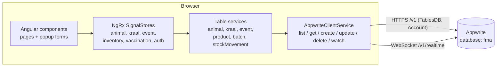
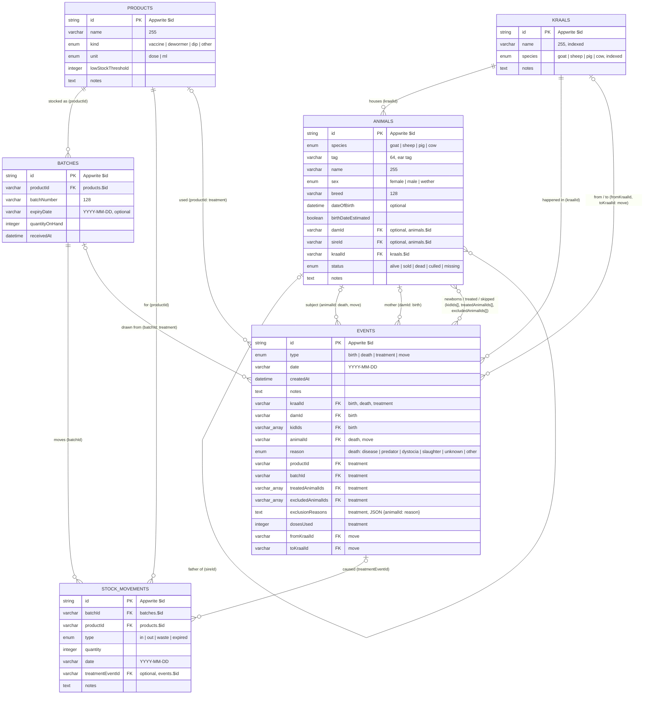

# AgroHerd

AgroHerd is livestock record-keeping software for smallholder farms in Botswana. A farmer (or farm hand) keeps a
register of every goat, sheep, pig and cow, organised by the kraal or pen it lives in, and records what happens to
the herd day to day: births, deaths, moves between kraals, and vaccinations, along with the medicine stock those
vaccinations draw from.

The repository is an [Nx](https://nx.dev) monorepo with two Angular apps and an [Appwrite](https://appwrite.io)
backend:

| Path                   | What it is                                                                                     |
| ---------------------- | ---------------------------------------------------------------------------------------------- |
| `apps/adminportal`     | **Farm Manager**, the signed-in app farmers use every day                                      |
| `apps/website`         | Public marketing site (home, livestock, features, about, contact)                              |
| `libs/ui`              | [Spartan UI](https://spartan.ng) Helm components (`@spartan-ng/helm/*`)                        |
| `libs/css/theme.css`   | Shared Tailwind CSS v4 theme (emerald green, light surfaces)                                   |
| `appwrite.config.json` | Appwrite project settings and the TablesDB schema, deployed with the Appwrite CLI              |
| `docs/`                | [Stack setup guide](docs/STACK_SETUP.md) and [technical debt register](docs/TECHNICAL_DEBT.md) |

---

## What the Farm Manager does

### Screens

| Screen            | Purpose                                                                                                                                                                                                                          |
| ----------------- | -------------------------------------------------------------------------------------------------------------------------------------------------------------------------------------------------------------------------------- |
| **Dashboard**     | Herd totals, births / deaths / vaccinations in the last 30 days, herd-by-species donut, monthly births vs deaths, animals per kraal, recent activity, low-stock and expiring-batch alerts                                        |
| **Animals**       | Searchable register (name or ear tag), filter by kraal and sex, optionally include sold / dead animals. Each animal has a detail page with its details, mother, offspring, history timeline and a "move to another kraal" action |
| **Kraals & pens** | Places animals live. Each kraal belongs to one species; its page lists the animals in it with shortcuts to add, vaccinate, record a birth or a death                                                                             |
| **Stock**         | Vaccines, dewormers and dips, with batches, expiry dates, quantity on hand and a low-stock threshold                                                                                                                             |

### Records (popup forms)

All data entry happens in popups that open over the current page from the **Record** menu, the sidebar, or the
shortcut buttons on a page. A popup is a route on a named `modal` outlet (for example
`/animals(modal:birth;damId=…)`), so it can be linked to, survives a refresh and closes with the back button.

| Popup               | What it records                                                                                                                                                           |
| ------------------- | ------------------------------------------------------------------------------------------------------------------------------------------------------------------------- |
| Add / edit animal   | Species, ear tag, name, kraal, sex, breed, date of birth (exact or estimated), notes                                                                                      |
| Record a birth      | Mother, kraal, date and one or more newborns (tag, name, sex). Creates the newborns and a `birth` event                                                                   |
| Record a death      | Animal, reason (disease, predator, birth trouble, slaughter, …), date. Marks the animal dead or culled and creates a `death` event                                        |
| Vaccinate a kraal   | Kraal, product, batch, date. Everyone is included; untick exceptions and say why. Deducts doses from the batch and writes a `treatment` event and an `out` stock movement |
| Add kraal / product | A new place or a new medicine                                                                                                                                             |
| Receive stock       | A new batch for a product, with quantity and expiry. Writes an `in` stock movement                                                                                        |

### Species-aware language

The app speaks the farmer's vocabulary for each species: kids, does and bucks and _kidding_ for goats; lambs, ewes
and rams and _lambing_ for sheep; piglets, sows and boars, _farrowing_ and _pens_ for pigs; calves, cows and bulls
and _calving_ for cattle. A species switch in the top bar narrows every screen to one species.

### Layout

The frame is Spartan's [inset sidebar with secondary navigation](https://spartan.ng/blocks/sidebar#sidebar-2)
block:

- **Sidebar:** logo, the four sections, the four Record actions, secondary links (sync status, help, feedback) and
  the signed-in user menu with log out.
- **Inset page:** a header with the sidebar toggle, breadcrumbs, the species switch and the Record menu.
- **Phones:** the sidebar becomes a slide-out sheet.

Dropdowns use Spartan Select and dates use the Spartan Date Picker, wrapped by `app-select` and `app-date-field`
(`apps/adminportal/src/app/core/ui`) so forms can bind plain strings and ISO dates.

---

## Architecture



- **Pages and popups** read signals from stores and call store methods. They never call Appwrite directly.
- **Stores** (`core/stores`) hold state and the business rules: a newborn's kraal must match the mother's species,
  ear tags must be unique among living animals of a species, and a vaccination can't use more doses than the batch
  holds.
- **Services** (`core/services`) map one table each onto `AppwriteClientService`, which wraps the Appwrite
  `TablesDB` SDK and Realtime subscriptions. Any change on a table makes the matching store reload.
- **Auth** is an Appwrite email/password session (`AuthStore`, `authGuard`).

### Tech stack

Angular 22 (standalone components, signals, signal forms), Nx 23, pnpm, Tailwind CSS v4, Spartan UI (Brain + Helm),
`@ng-icons/lucide`, NgRx Signals, Appwrite (TablesDB + Realtime + Account).

---

## Database

Everything lives in one Appwrite TablesDB database, **`fma`**, with six tables. Appwrite adds `$id`, `$createdAt`,
`$updatedAt` and `$permissions` to every row. Relationships are stored as plain string ids (`varchar(36)`): Appwrite
does not enforce them, and the stores keep them consistent.



### How the tables work together

- **`events`** is one polymorphic table. `type` says which columns are used:

  | `type`      | Columns used                                                                                                    |
  | ----------- | --------------------------------------------------------------------------------------------------------------- |
  | `birth`     | `damId`, `kraalId`, `kidIds[]`                                                                                  |
  | `death`     | `animalId`, `kraalId`, `reason`                                                                                 |
  | `treatment` | `kraalId`, `productId`, `batchId`, `treatedAnimalIds[]`, `excludedAnimalIds[]`, `exclusionReasons`, `dosesUsed` |
  | `move`      | `animalId`, `fromKraalId`, `toKraalId`                                                                          |

  An animal's history is every event that names it in any of those columns.

- **Stock** is tracked twice on purpose. `batches.quantityOnHand` is the running balance used for decisions, and
  `stockMovements` is the audit trail (`in` when stock is received, `out` when a vaccination uses it).
- **Recording a birth** creates one `animals` row per newborn (same species and breed as the mother, `damId` set,
  born in the chosen kraal) plus one `birth` event.
- **Recording a death** sets the animal's `status` to `dead`, or `culled` when the reason is slaughter, and adds a
  `death` event. Animals are never deleted, so their history stays complete.
- **Indexes** cover the common filters: `animals(species,status)`, `animals(kraalId,status)`, `events(date)`,
  `events(animalId)`, `batches(productId)`, `batches(expiryDate)` and others (see `appwrite.config.json`).
- **Permissions** are table-level: any signed-in user can create, read, update and delete every row (see
  [technical debt](docs/TECHNICAL_DEBT.md#1-no-separation-between-farms)).

---

## Getting started

Prerequisites: Node.js 22+, pnpm 11 (`corepack enable`), the [Appwrite CLI](https://appwrite.io/docs/tooling/command-line/installation)
and an Appwrite instance. Locally this repo expects self-hosted Appwrite on `http://localhost:81`.

```sh
pnpm install

# Create the database and tables on your Appwrite instance
appwrite login --endpoint http://localhost:81/v1
appwrite push tables

# Farm Manager on http://localhost:4200 (proxies /v1 to Appwrite, see proxy.conf.json)
pnpm nx serve adminportal

# Marketing site
pnpm nx serve website
```

In the Appwrite console, add a **Web platform** for `localhost` and create a user (email + password) to sign in
with. The project and database ids are in `apps/adminportal/src/app/core/appwrite/appwrite.constants.ts`.

| Command                                         | What it does                                                |
| ----------------------------------------------- | ----------------------------------------------------------- |
| `pnpm nx build adminportal`                     | Production build to `dist/apps/adminportal`                 |
| `pnpm nx build website`                         | Production build to `dist/apps/website`                     |
| `pnpm nx lint adminportal`                      | ESLint                                                      |
| `appwrite pull tables` / `appwrite push tables` | Sync the schema between Appwrite and `appwrite.config.json` |

To rebuild the stack from nothing (Tailwind v4 + Spartan + SignalStore + Appwrite CLI + proxy), follow the
[stack setup guide](docs/STACK_SETUP.md).

## Project layout

```text
apps/adminportal/src/app/
  app.routes.ts            Pages (lazy) + popup routes on the "modal" outlet
  layout/                  Shell: Spartan inset sidebar, header, breadcrumbs, Record menu
    sidebar/               nav-main, nav-record, nav-secondary, nav-user
  core/
    appwrite/              SDK client, endpoint + project/database ids
    auth/                  authGuard / guestGuard
    data/                  AppwriteClientService (list/get/create/update/delete/watch)
    models/                Row types, species vocabulary, labels
    services/              One service per table
    stores/                NgRx SignalStores (state + business rules)
    ui/                    Modal host/service, toasts, select + date fields, charts, logo, species avatar
    utils/                 Dates, errors, icon registry
  features/
    dashboard/  animals/  kraals/  births/  deaths/  vaccination/  inventory/  login/
apps/website/src/app/      Marketing pages; copy in core/content/site.ts
libs/ui/<component>/       Spartan Helm components
libs/css/theme.css         Design tokens and shared component classes
```

## Deployment

The recommended setup is static hosting for both apps and Appwrite on a subdomain of the same root domain, with
CI checks on every pull request. See [Deployment](docs/TECHNICAL_DEBT.md#recommended-deployment) for the steps and
reasoning.
