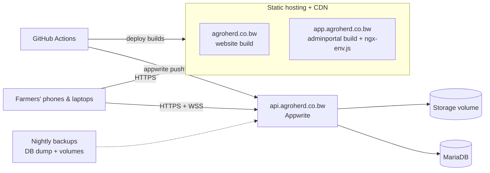

# Technical debt and improvements

This document lists what to fix or improve in AgroHerd, ordered by risk, and then recommends how to deploy it.
Each item says what is wrong, why it matters, and a suggested fix. It describes the code as of November 2026; tick
items off or delete them as they are resolved.

**Priority key:** 🔴 fix before real farms use it · 🟠 fix soon · 🟡 worth doing · ⚪ nice to have

## Summary

| #   | Item                                                                                                             | Area                | Priority |
| --- | ---------------------------------------------------------------------------------------------------------------- | ------------------- | -------- |
| 1   | [No separation between farms](#1-no-separation-between-farms)                                                    | Security / data     | 🔴       |
| 2   | [Multi-step writes are not atomic](#2-multi-step-writes-are-not-atomic)                                          | Data integrity      | 🔴       |
| 3   | ["Works offline" is promised but not built](#3-works-offline-is-promised-but-not-built)                          | Product / honesty   | 🔴       |
| 4   | [Hard-coded Appwrite endpoint and ids](#4-hard-coded-appwrite-endpoint-and-ids)                                  | Config / deploy     | ✅ Fixed |
| 5   | [Auth settings are looser than needed](#5-auth-settings-are-looser-than-needed)                                  | Security            | 🟠       |
| 6   | [No automated tests](#6-no-automated-tests)                                                                      | Quality             | 🟠       |
| 7   | [No CI/CD pipeline](#7-no-cicd-pipeline)                                                                         | Delivery            | 🟠       |
| 8   | [Everything is loaded into memory](#8-everything-is-loaded-into-memory)                                          | Performance / scale | 🟠       |
| 9   | [Paged kraal list doubles as the global lookup](#9-paged-kraal-list-doubles-as-the-global-lookup)                | Correctness         | 🟠       |
| 10  | [Schema inconsistencies](#10-schema-inconsistencies)                                                             | Data model          | 🟠       |
| 11  | [Uniqueness and integrity checked only in the browser](#11-uniqueness-and-integrity-checked-only-in-the-browser) | Data integrity      | 🟠       |
| 12  | [Errors are swallowed](#12-errors-are-swallowed)                                                                 | Operability         | 🟠       |
| 13  | [Website advertises features that don't exist](#13-website-advertises-features-that-dont-exist)                  | Product             | 🟡       |
| 14  | [Initial bundle is over budget](#14-initial-bundle-is-over-budget)                                               | Performance         | 🟡       |
| 15  | [Popup focus is not trapped](#15-popup-focus-is-not-trapped)                                                     | Accessibility       | 🟡       |
| 16  | [Unused code and assets in the repo](#16-unused-code-and-assets-in-the-repo)                                     | Hygiene             | 🟡       |
| 17  | [Code duplicated between the two apps](#17-code-duplicated-between-the-two-apps)                                 | Maintainability     | 🟡       |
| 18  | [Missing product features](#18-missing-product-features)                                                         | Product             | ⚪       |
| 19  | [Small clean-ups](#19-small-clean-ups)                                                                           | Hygiene             | ⚪       |

---

## 🔴 Fix before real farms use it

### 1. No separation between farms

**What:** All six tables use table-level permissions `create/read/update/delete("users")` with `rowSecurity: false`
(`appwrite.config.json`). There is no `farmId` or team on any row.

**Why it matters:** Every signed-in user can see and change every other farm's animals, events and stock. As soon as
a second farm signs up, their data is mixed together and exposed.

**Fix:**

1. Model each farm as an **Appwrite Team**; farm owners invite their workers to the team.
2. Turn on `rowSecurity` and write each row with `read/update/delete("team:<farmId>")`. Remove the blanket
   `"users"` table permissions (keep `create("users")` if rows are created client-side).
3. Add a `farmId` column (indexed) to every table so queries and reports can filter by farm.
4. Add team roles if needed (owner can delete; worker can record).

### 2. Multi-step writes are not atomic

**What:** Several store methods make a series of separate API calls:

- `VaccinationStore.vaccinateKraal`: reads the batch, writes `quantityOnHand - doses`, creates the event, then
  creates the stock movement.
- `AnimalStore.recordBirth`: creates one row per newborn, then the event.
- `AnimalStore.recordDeath` and `moveToKraal`: update the animal, then create the event.
- `InventoryStore.receiveStock`: creates the batch, then the movement.

**Why it matters:**

- **Partial failures.** A dropped connection halfway leaves stock deducted with no event, or newborns with no birth
  record.
- **Lost updates on stock.** The read-modify-write on `quantityOnHand` can lose an update when two people vaccinate
  from the same batch at once.

**Fix:**

- **Atomic writes:** use **TablesDB transactions** (`createTransaction` → operations with `transactionId` →
  commit). They are supported by the installed `appwrite@26` SDK and Appwrite 1.8+.
- **Safe stock changes:** use `decrementRowColumn` for stock instead of read-modify-write, with a minimum of 0 so
  stock can't go negative.
- **Move business rules server-side:** consider moving these operations into an **Appwrite Function** so the rules
  (species match, tag uniqueness, enough stock) are enforced on the server.

### 3. "Works offline" is promised but not built

**What:** The website ("Works without signal", "Records sync when you are back online") and earlier app copy
promise offline use. In reality there is no service worker and no local storage or outbox, and every write goes
straight to Appwrite. `OnlineStore` only reads `navigator.onLine`. The in-app copy has been corrected to "Offline ·
changes won't save", but the website still makes the claim.

**Why it matters:** This is the core promise for rural farms with patchy signal. Farmers will lose records they
believe were saved.

**Fix (pick one):**

- **Build it:**
  - Add `@angular/service-worker` (app shell caching).
  - Keep a local copy of the herd in **IndexedDB**.
  - Queue writes in an outbox, replay them on reconnect, and resolve conflicts with `$updatedAt` (last-write-wins
    per row is usually enough here).
  - Show "N changes waiting to sync" in the sidebar status item.
- **Or stop promising it:** remove the offline claims from `apps/website/src/app/core/content/site.ts` and the
  home page until it ships.

### 4. Hard-coded Appwrite endpoint and ids

**Status: fixed.**

**What (was):** `appwrite.constants.ts` hard-coded the project and database ids. It also picked the endpoint by checking
whether the browser was on port 4200, and fell back to `http://localhost:81/v1`.

**Why it mattered:** A production build pointed at `localhost`. Staging and production couldn't share one build, and
changing the Appwrite host meant editing code.

**Fixed:** `@ngx-env/builder` reads `.env` and exposes `import.meta.env.NG_APP_*` (see
[Environment variables](STACK_SETUP.md#52-environment-variables-env)). Override per branch with CI environment
variables, or replace the generated `ngx-env.js` per environment so one build can be promoted from dev to
production.

---

## 🟠 Fix soon

### 5. Auth settings are looser than needed

**What:** `appwrite.config.json` enables JWT, phone, magic URL, email OTP and invites, though the app only uses
email/password. Sessions last a year (`duration: 31536000`), and the password dictionary and personal-data checks
are off.

**Fix:**

- Disable the unused sign-in methods.
- Shorten sessions to around 30 days.
- Turn on `passwordDictionary` and `personalDataCheck`.
- Consider session alerts.
- Add password reset (the app has no "Forgot password" flow) and email verification.

### 6. No automated tests

**What:** The workspace was created with `--unitTestRunner=none --e2eTestRunner=none`, so there are zero tests.

**Fix:**

- **Unit tests (Vitest):** cover `core/utils/dates.ts`, the species vocabulary, the store rules (tag uniqueness,
  kraal/species match, vaccination stock math) and the dashboard calculations.
- **End-to-end tests (Playwright):** cover sign-in, adding a kraal and an animal, recording a birth, vaccinating a
  kraal and checking stock, and recording a death. Run them against a throwaway Appwrite or a mocked `/v1` (a mock
  server that serves the build and fakes `/v1/account` and `/v1/tablesdb/.../rows` is enough for UI flows).

### 7. No CI/CD pipeline

**What:** Nothing runs lint, build or tests on push, and the Appwrite schema is pushed by hand.

**Fix:** Add a GitHub Actions workflow:

1. **On every pull request:**
   - Install with `pnpm install --frozen-lockfile`.
   - Run `nx affected -t lint test build` and the Playwright tests.
2. **On merge to `main`:**
   - Build both apps.
   - Deploy them to staging.
   - Run `appwrite push tables` against the staging project (CLI with an API key stored as a secret).
3. **On tag:** promote the same artifacts to production and push the schema to the production project.

### 8. Everything is loaded into memory

**What:**

- **Whole tables at load:** the animal store's `herd`, the event store and the inventory store load whole tables
  (`listAll` pages through every row) when the app starts.
- **Full reloads on every change:** each Realtime event on a table triggers a full reload.
- **Dashboard maths in the browser:** the dashboard computes everything client-side.

**Why it matters:** Fine for a few hundred animals. With thousands of animals and years of events, startup slows
down and every change from another device re-downloads everything (costly on mobile data).

**Fix:**

- **Smaller event loads:** load events per period, for example the last 12 months, and page older history on the
  animal page.
- **Incremental updates:** apply the Realtime payload to the in-memory list (insert, update or remove one row)
  instead of re-fetching.
- **Server-side totals:** move dashboard totals to a scheduled Appwrite Function that writes a small `stats` table
  per farm, or use `Query.select` and count queries.

### 9. Paged kraal list doubles as the global lookup

**What:** `KraalStore.kraals` holds the current page of the Kraals screen (10 per page), but every form, picker
and label also reads it to resolve kraal names. `AnimalStore.unfilteredList` used to overwrite it as well.

**Why it matters:** A farm with more than 10 kraals will see "—" for kraal names and missing choices in pickers.

**Fix:** Mirror what was done for animals (`herd` vs `animals`). Add an unfiltered `allKraals` state that is loaded
once and kept fresh by Realtime, and keep `kraals` for the paged list only.

### 10. Schema inconsistencies

**What:**

- **Mixed date types:** `animals.dateOfBirth` is `datetime`, while `events.date`, `batches.expiryDate` and
  `stockMovements.date` are `varchar(10)` ISO dates.
- **Required free-text fields:** `notes` is required on most tables, so the code writes `''` everywhere.
- **JSON in a text column:** `events.exclusionReasons` is a JSON string, so it can't be queried and has no
  validation.
- **Unused or redundant columns:** `events.createdAt` duplicates `$createdAt`, and `sireId` exists but nothing in
  the UI sets it.
- **Sparse polymorphic table:** `events` has 17 columns, most of them empty for any given type.
- **Unused stock movement types:** `stockMovements` has `waste` and `expired` types that no screen creates.

**Fix:**

- Standardise on `varchar(10)` ISO dates for calendar dates (or `datetime` everywhere) and migrate once.
- Make `notes` optional.
- Replace `exclusionReasons` with a small `treatmentExclusions` table (`eventId`, `animalId`, `reason`), or with
  two aligned arrays.
- Either add a sire picker or drop `sireId`.
- Keep the polymorphic `events` table (it works well for the timeline) but document which columns each type uses
  (now in the README) and validate them in one place.

### 11. Uniqueness and integrity checked only in the browser

**What:** Ear-tag uniqueness, "kraal species must match animal species" and "don't delete a kraal with animals"
are all checked client-side. The kraal-delete check even downloads every animal to do it.

**Why it matters:** Two devices can create the same tag at the same time, and a modified client can bypass every
rule.

**Fix:** Enforce these rules in an Appwrite Function (see item 2). For tags, add a unique index on
`(farmId, species, tag)` and mark sold or dead animals by moving the tag into a `previousTag` column, so living
tags stay unique. Use `Query.equal('kraalId', id)` with `Query.limit(1)` for the delete check.

### 12. Errors are swallowed

**What:** Stores catch errors and fall back to empty lists (`patchState(store, { animals: [] })`) or a generic
message. Nothing is logged anywhere.

**Why it matters:** A permissions or network problem looks like "no animals yet", and nobody finds out.

**Fix:**

- Show a retryable error state on list pages.
- Add a global `ErrorHandler` that reports to an error tracker such as Sentry or GlitchTip (self-hostable).
- Distinguish 401 errors (send the user to the sign-in page) from network errors (show an offline banner).

---

## 🟡 Worth doing

### 13. Website advertises features that don't exist

The website lists **"Backup you control: export a JSON backup and restore it"** and **"Deaths and sales"**. Neither
backup/restore nor a sale flow exists in the app (status `sold` can only be set in data). Either build them, which
is small (see item 18), or remove the claims.

### 14. Initial bundle is over budget

**What:** The admin production build is about **847 kB initial (190 kB gzipped)**, against the 500 kB budget in
`project.json`. Pages are already lazy-loaded; the app shell (sidebar, dropdown menu, select, CDK overlay) and the
Appwrite SDK make up most of the size.

**Fix:**

- Check the bundle with `ng build --stats-json` and `esbuild` analyse.
- Lazy-load the record popups' heavier dependencies such as the calendar.
- Make sure only the lucide icons in use are registered (already done).
- Then set a realistic budget, for example 600 kB warning and 900 kB error, so regressions get caught.

### 15. Popup focus is not trapped

**What:** `ModalHostComponent` moves focus into the popup and restores it on close, but Tab can still reach the
page behind it.

**Why the custom host:** Popups don't use a native `<dialog>` because the browser's top layer would hide Spartan's
select and date-picker overlays.

**Fix:** Add `cdkTrapFocus` from `@angular/cdk/a11y` to the panel, or switch to Spartan Dialog (`hlm-dialog`), which
traps focus and stacks correctly with other CDK overlays.

### 16. Unused code and assets in the repo

- **Unused Spartan libraries:** about 40 vendored libraries in `libs/ui` are never imported (accordion, carousel,
  command, questionnaire, …). Delete them, or leave them deliberately as a component kit.
- **Unused assets:** `libs/fonts/poppins` (3 MB) and `libs/img/logo.png` are no longer used. The app uses system
  fonts and the SVG logo.
- **Unused admin files:** `apps/adminportal/public/logo.png` and `favicon.ico` are superseded by `favicon.svg`.
- **Unused libs:** after the move to popups, `libs/ui/pagination`, `radio-group`, `accordion` (admin only) and
  `card` are barely or never used by the admin app.

### 17. Code duplicated between the two apps

`species-icons.ts`, the lucide icon registry, the species vocabulary and the logo SVG exist in both apps. Move them
to a shared library, for example `libs/domain` (species vocabulary, labels, breeds) and `libs/brand` (logo, icons),
with tsconfig path aliases.

---

## ⚪ Nice to have

### 18. Missing product features

- **Sales:** record a sale (buyer, price, date). This sets status `sold` and creates a `sale` event.
- **Backup / restore:** export everything for a farm as JSON or CSV, and import it.
- **Weights and body condition:** add a `measurements` table for growth tracking.
- **Breeding:** record matings and expected birth dates, with reminders before kidding, lambing, farrowing or
  calving.
- **Withdrawal periods:** a product's milk and meat withdrawal days, with "do not sell until" warnings after
  treatment.
- **Setswana translation:** use Angular i18n or Transloco. The species vocabulary is already centralised, which
  makes this easier.
- **Dark mode:** the theme only defines light tokens. Add a `:root.dark` block and a toggle in the user menu.
- **Reports:** printable herd register and vaccination certificates (PDF).
- **Photos:** use Appwrite Storage for animal photos and ear-tag images.

### 19. Small clean-ups

- The folder `core/stores/fetures` is misspelt; rename it to `features`.
- `AnimalStore` imports services under aliases (`AnimalService as AnimalDataService`). Use the real names.
- In the vaccinate popup, the species vocabulary falls back to goat when no kraal is chosen. Show neutral wording
  instead.
- The website contact form only opens the visitor's mail app (`mailto:`), so enquiries are never stored. Use an
  Appwrite Function to save leads and notify the team.

---

## Recommended deployment

### Target architecture

### 1. Frontends: static hosting

Both apps build to static files (`dist/apps/*/browser`). Host them on any static host with a CDN and SPA fallback:
**Appwrite Sites** (keeps everything in one platform), **Cloudflare Pages** or **Netlify**. Configure:

- SPA fallback: unknown paths → `index.html` (needed for deep links like `/animals/abc`).
- Long cache headers for hashed assets (`*.js`, `*.css`) and `no-cache` for `index.html` and `ngx-env.js`.
- Per-environment `ngx-env.js`, or `NG_APP_*` variables set in CI per branch (see item 4).

### 2. Backend: Appwrite on the same root domain

Put Appwrite on a **subdomain of the app's domain**, for example `api.agroherd.co.bw` for
`app.agroherd.co.bw`. Appwrite sessions are cookies, and browsers (Safari in particular) block third-party
cookies. If the API is on a different root domain, sign-in silently fails on iPhones. This is the same reason the
dev setup proxies `/v1` through `localhost:4200`.

Choose one:

- **Appwrite Cloud.** Least operations work: managed backups, upgrades and TLS. Add `api.agroherd.co.bw` as a
  custom domain. Latency from Botswana to the nearest region is acceptable for this workload; check the regions on
  offer and their data-residency terms first.
- **Self-hosted Appwrite** (the current dev setup) on a VPS, for example a 2 vCPU / 4 GB instance in a
  Johannesburg or Cape Town region to minimise latency:
  - Run the official Docker Compose stack behind Traefik (bundled) with Let's Encrypt.
  - Back up nightly: a `mysqldump` of MariaDB plus the `appwrite-uploads` and `appwrite-config` volumes, copied
    off-site (S3 or Backblaze B2), and test restores.
  - Pin the Appwrite version and upgrade deliberately with the official migration command.
  - Monitor uptime with an external checker, and watch disk and CPU.

### 3. Environments

Use **two Appwrite projects**, dev and production, with the same `appwrite.config.json` pushed to both. CI sets the
`NG_APP_APPWRITE_*` variables per branch (`dev` → dev Appwrite, `main` → production), or builds once and swaps
`ngx-env.js` when promoting. In the Appwrite console, register each site's hostname as a Web platform in its
project.

### 4. Pipeline

See item 7: build, lint and test on every pull request; deploy to staging on merge; promote to production on a
tag. Apply schema changes with `appwrite push tables`. Make sure each change is backwards-compatible: add columns
first, ship the code, then remove old columns in a later release.

### 5. Before go-live checklist

- [ ] Items 1–4 above are fixed (farm isolation, atomic writes, honest offline story, runtime config)
- [ ] Auth hardened (item 5), password reset and email verification working
- [ ] Production Web platform hostnames registered; Appwrite on the same root domain as the app
- [ ] Backups running and a restore tested
- [ ] Error tracking (item 12) and uptime monitoring in place
- [ ] Privacy notice on the website (personal data: names, emails, phone numbers)
